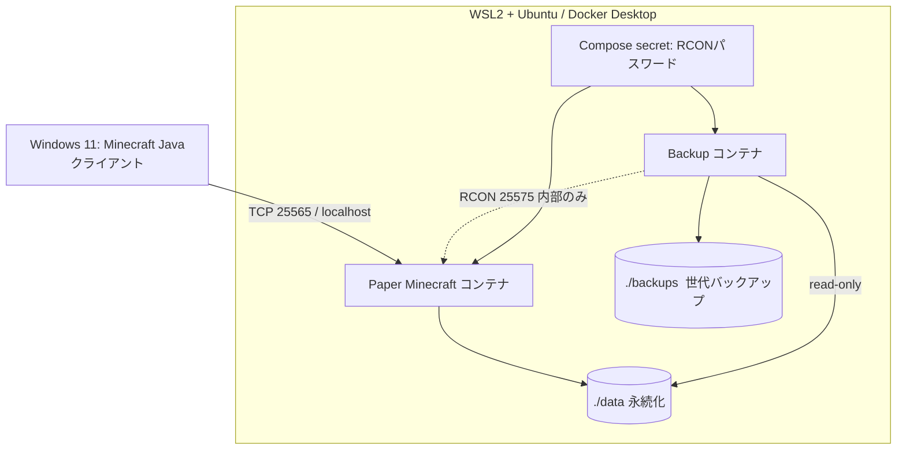

# アーキテクチャ設計

## 図

## ポート設計

| ポート | 通信 | 用途 | 公開範囲 |
|---|---|---|---|
| 25565/TCP | クライアント → Paper | Java版Minecraft | 127.0.0.1のみ |
| 25575/TCP | Backup → Paper | RCON管理用 | Docker内部のみ（ports未指定） |

## 設計上の判断
- ローカルで安全に学習するため `127.0.0.1` バインドを採用。
- 設定は `compose.yaml`、実行時データは `data/` に分離。
- `data/` を永続化し、コンテナを作り直してもワールドを残す。
- `backups` サービスは読み取り専用で `data/` をマウント。
- 保存データは GitHub へ載せず、バックアップは別系統で保持することが本番運用では望ましい。
- 初期導入後に Paper ゲームバージョン・コンテナイメージの固定を行う。

## 今後の拡張
- Linux VPS / AWS EC2 への移行、SSH鍵認証、OSパッチ、最小権限
- TCP 25565 の送信元IP制限 / セキュリティグループ
- Prometheus / Grafana による CPU、メモリ、TPS、可用性監視
- Cloud上の別ストレージへのバックアップ複製
- 復旧目標 (RTO/RPO) の設定と復元テスト
